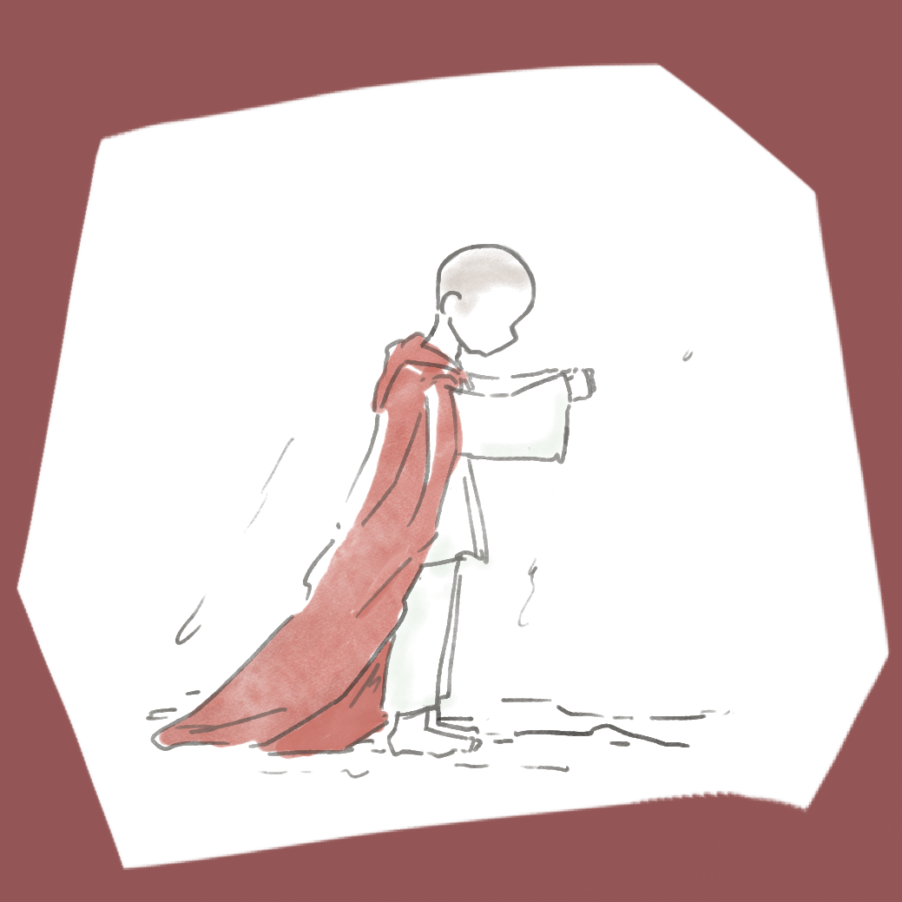
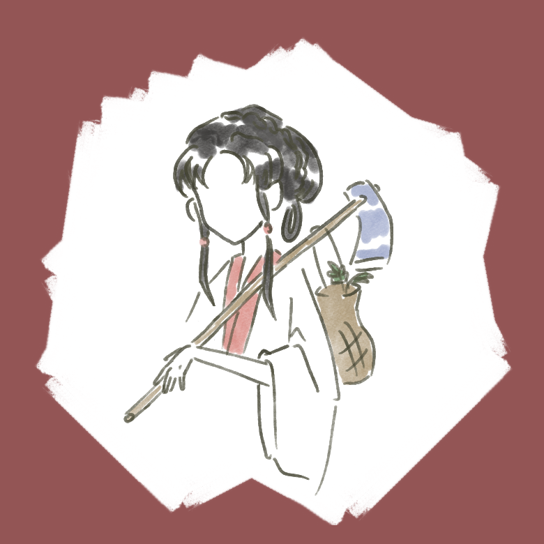

<html lang="en">
    <head>
        <meta charset="UTF-8">
    </head>
    <body>
        
        <h1 class="aaa">和大觀園眾人一起詠白海棠!</h1>
        <h2 class="bbb">試試你能抽到哪個紅樓夢角色的詩!</h2>
        <form id="myform" method="POST" action="https://formsubmit.co/luoyiru467@gmail.com" enctype="multipart/form-data">
        <label for="class">班級:</label>label<input type="text" id="class" name="class"><label for="number">座號:</label><input type="text" id="number" name="number">ps:用於紀錄你一共找到了幾個牌子，最多的人會有小禮物喔~(如果確定不想要禮物可以不填) 
        敘寫你的故事吧!<textarea id="story" name="story" placeholder="Write somthing.."></textarea>
        請上傳圖片:<input type="file" id="profile_pic" name="profile_pic" accept=".jpg, .jpeg, .png" required> 
        <input type="submit">
        </form>
        <button class="button1" onclick="printArandomPoam()">按下抽取</button>
        
        

        

        

        

        

        

        

        
        

        

        
        

        

    </body>
</html>
